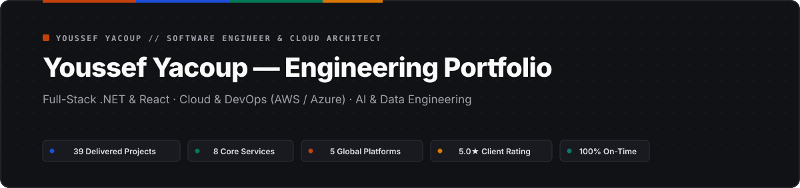

 

---

<table>
<tr>
<td width="160" align="center" valign="middle">
  
</td>
<td valign="middle">

### Youssef Yacoup · يوسف يعقوب
**AI & Backend Developer — Python · C# / .NET · ASP.NET Core · SQL · Azure · React** · Cairo, Egypt

I build **Python machine-learning prototypes**, **.NET & Azure REST backends**, and **AI-powered web applications** — turning datasets or workflows into documented, testable software.

أبني <b>نماذج تعلّم الآلة بلغة Python</b> و<b>أنظمة Backend وواجهات REST API بتقنيات C# / .NET و Azure</b> وتطبيقات ويب عملية — أحوّل بياناتك أو فكرتك إلى منتج قابل للتشغيل بتوثيق واضح.

</td>
</tr>
</table>

---

## 🌐 Services & Portfolio · الخدمات ومعرض الأعمال

> Explore all **39 portfolio projects**, **8 services**, real screenshots, and interactive demos on my website or in the repository:
> - **Interactive Website (AR / EN)**: [**youssef123ya.github.io/Freelancer-Platforms**](https://youssef123ya.github.io/Freelancer-Platforms/)
> - **Full Repository**: [**github.com/Youssef123ya/Freelancer-Platforms**](https://github.com/Youssef123ya/Freelancer-Platforms)
> - **Direct WhatsApp**: [**+20 127 341 3749**](https://wa.me/201273413749)

| Platform · المنصة | Profile · الحساب | Scope & Rate · النطاق |
|---|---|---|
| **Upwork** | [upwork.com/freelancers/~016f07b2d17f649923](https://www.upwork.com/freelancers/~016f07b2d17f649923) | `$20/hr` · >30 hrs/wk · AI, ML & .NET Backends |
| **Freelancer.com** | [freelancer.com/u/yyacoup](https://www.freelancer.com/u/yyacoup) | `$10/hr` · 16 portfolio items · Python, .NET, Web |
| **Mostaql · مستقل** | [mostaql.com/u/yyacoup](https://mostaql.com/u/yyacoup) | ID Verified (`هوية موثقة`) · Software & AI Projects |
| **Nafezly · نفذلي** | [nafezly.com/u/YoussefYacoup](https://nafezly.com/u/YoussefYacoup) | 20 portfolio items · Backend, AI, Data & Branding |
| **Khamsat · خمسات** | [khamsat.com/user/youssefyacoup](https://khamsat.com/user/youssefyacoup) | ID Verified · Landing Pages starting at `$10` |

---

## ⭐ Selected Projects & Competition Highlights · أبرز المشاريع

| Project | Stack & Achievement | Links |
|---|---|---|
| **InvoicePilot** | AI invoice assistant converting work notes into human-reviewed PayPal Sandbox invoices (`Gemini`, `React`, `TypeScript`, `Cloudflare Workers`). Built for PayPal AI Hackathon. | [Repo](https://github.com/Youssef123ya/invoicepilot-paypal-ai) · [Devpost](https://devpost.com/software/invoicepilot-s9euh1) · [Case Study](https://github.com/Youssef123ya/Freelancer-Platforms/tree/main/portfolio/ai/invoicepilot) |
| **MedMonitor 24/7** | Hospital bed & vital-signs monitoring system scoring **100/100** (Top 15 graduation project); built `.NET` backend & `Azure` cloud services. | [Repo](https://github.com/Youssef123ya/MedMonitor-24-7) · [Case Study](https://github.com/Youssef123ya/Freelancer-Platforms/tree/main/portfolio/backend/medmonitor-24-7) |
| **Sand Dune Encroachment Tracker** | **1st Place in TechMind Challenge 3** — Geospatial ML prototype forecasting sand dune movement from satellite imagery (`Python`, `GIS`). | [Repo](https://github.com/Youssef123ya/Challenge-3-Sand-Dune-Encroachment-Tracker) · [Case Study](https://github.com/Youssef123ya/Freelancer-Platforms/tree/main/portfolio/ai/sand-dune-encroachment-tracker) |
| **Kaggle Competitions (2× 🥉)** | **2 Bronze Medals**: *AI Agent Security* (Rank 377 / 4,186 — Top 9%) & *ROGII Wellbore Geology Prediction*. | [Repo](https://github.com/Youssef123ya/Kaggle-Competitions) · [Kaggle](https://www.kaggle.com/youssefyacoup) · [Certificate](https://www.kaggle.com/certification/competitions/youssefyacoup/ai-agent-security-multi-step-tool-attacks) |
| **rollout-trace** | Incident research desk tracing deployment failures to verifiable sources (ODSC × Nebius, `JavaScript`). | [Repo](https://github.com/Youssef123ya/rollout-trace) |
| **sleight-of-eye** | Seated WebXR game for Meta Quest using Immersive Web SDK (Meta VR Start 2026, `TypeScript`). | [Repo](https://github.com/Youssef123ya/sleight-of-eye) |
| **ghostlight-kiroween-2026** | Browser-local accessibility repair workshop for HTML (Kiroween 2026, `JavaScript`). | [Repo](https://github.com/Youssef123ya/ghostlight-kiroween-2026) |

---

## 🧰 Technical Stack & Credentials · التقنيات والخبرات

<table>
<tr>
<td valign="top" width="50%">

**Tech Stack**
- **Backend & APIs**: `C#` · `ASP.NET Core` · `.NET` · `Python` · `Node.js` · `REST APIs` · `SQL`
- **AI & Data Science**: `Machine Learning` · `pandas` · `scikit-learn` · `Gemini / LLM APIs` · `GIS` · `Excel / Power Query`
- **Cloud & DevOps**: `Microsoft Azure` · `Google Cloud` · `AWS` · `Docker` · `Terraform` · `Cloudflare Workers`
- **Frontend & Web**: `React` · `TypeScript` · `JavaScript` · `HTML5 / CSS3` · `Tailwind CSS` · `WordPress / Shopify`

</td>
<td valign="top" width="50%">

**Experience & Education**
- **ML Engineer (Part-time)** — Shipd / Datacurve *(Mar 2026 – Present)*
- **Freelance Backend Developer** — ALX Ventures *(Oct 2024 – Present)*
- **B.Sc. Computer Science (IT)** — Nahda University *(2022 – 2026)*
- **Certifications**: ALX / Holberton Backend · [IBM Full Stack (Coursera)](https://www.coursera.org/verify/professional-cert/86A8LFNLFG9B) · Google Cloud AI in Action · DEPI React · GTC Machine Learning · ITI React & PHP

</td>
</tr>
</table>

---

**[🌐 Portfolio Website](https://youssef123ya.github.io/Freelancer-Platforms/)** &nbsp;·&nbsp; **[💬 WhatsApp: +20 127 341 3749](https://wa.me/201273413749)** &nbsp;·&nbsp; **[💼 LinkedIn](https://www.linkedin.com/in/youssef-yacoup-745234280/)** &nbsp;·&nbsp; **[🗂️ Full Services & Portfolio Repo](https://github.com/Youssef123ya/Freelancer-Platforms)**

